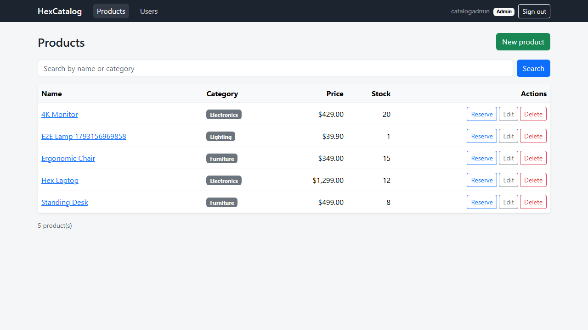

# HexCatalog

Product catalog with a .NET 10 API and a Blazor admin UI. Admins manage products and accounts, staff search the catalog and reserve stock, and new sign-ups wait for approval.

License: Apache-2.0. Keep `LICENSE` and `NOTICE` if you fork it.
Author: Daniel Llano ([github.com/daniel-llano](https://github.com/daniel-llano))



## Layout

```
hex-catalog/
├── api/     ASP.NET Core API: domain, CQRS handlers (MediatR), EF Core on SQL Server
├── web/     Blazor Web App (interactive server) that talks to the API
├── infra/   docker-compose for SQL Server, API, and admin UI
├── e2e/     Playwright tests against the compose stack
└── scripts/ run, test, e2e, migrate
```

Both apps follow ports and adapters. The API's domain and application layers don't know about EF Core or HTTP, and the admin's pages only see `IProductService`.

## Run it

You need Docker.

```bash
./scripts/run.sh        # or .\scripts\run.ps1
```

| What | Where |
|------|-------|
| Admin UI | http://localhost:5152 |
| API + Swagger | http://localhost:5090/swagger |
| SQL Server | localhost:1433 |

Sign in as `catalogadmin` / `Admin@1234`. Compose seeds four sample products.

To work on the code without containers, start SQL Server with `docker compose -f infra/docker-compose.yml up sqlserver`, then:

```bash
dotnet run --project api/src/HexCatalog.Api      # http://localhost:5090, uses appsettings.Development.json
dotnet run --project web/src/HexCatalog.Admin    # http://localhost:5152
```

## Roles

| Role | Can do |
|------|--------|
| Admin | Everything, including product CRUD and managing users |
| User | Search products, view details, reserve stock |
| Viewer | Sign in only. Self-registered accounts start here until an admin promotes them |

Callers can't pick a role when they register. The first admin comes from `Bootstrap:AdminUsername` and `Bootstrap:AdminPassword`.

## API

| Method | Path | Who |
|--------|------|-----|
| POST | `/api/auth/register`, `/login`, `/refresh`, `/logout` | Anyone |
| GET | `/api/products?q=&page=&pageSize=` | Admin, User |
| GET | `/api/products/categories`, `/api/products/{id}` | Admin, User |
| POST | `/api/products/{id}/reserve` | Admin, User |
| POST, PUT, DELETE | `/api/products`, `/api/products/{id}` | Admin |
| GET, PUT, DELETE | `/api/users`, `/api/users/{id}/role`, `/api/users/{id}` | Admin |
| GET | `/health/live`, `/health/ready` | Anyone |

Errors come back as RFC 9457 problem details. Validation failures list the bad fields, a stale update returns 409, and reserving more than what's in stock returns 422.

Refresh tokens rotate on every use and only their SHA-256 hash is stored.

## Configuration

| Key | Notes |
|-----|-------|
| `ConnectionStrings:DefaultConnection` | SQL Server |
| `Jwt:Secret` | Required, 32+ characters. The API won't start without it |
| `Jwt:AccessTokenMinutes`, `Jwt:RefreshTokenDays` | Default 60 and 7 |
| `Cors:Origins` | Browser origins allowed to call the API. `*` is rejected |
| `ApplyMigrationsOnStartup` | Off by default. Use `scripts/migrate.sh` or a pipeline step in production |
| `SeedSampleData`, `EnableSwagger` | Off by default |
| `ApiSettings:BaseUrl` | Admin UI only: where the API lives |

Set them with environment variables in production (`Jwt__Secret`, `ConnectionStrings__DefaultConnection`, and so on). The values in `infra/docker-compose.yml` are for local use.

## Tests

```bash
./scripts/test.sh       # unit + integration (EF in-memory, no SQL Server needed)
./scripts/e2e.sh        # Docker stack + Playwright
```

See [TESTING.md](TESTING.md).
